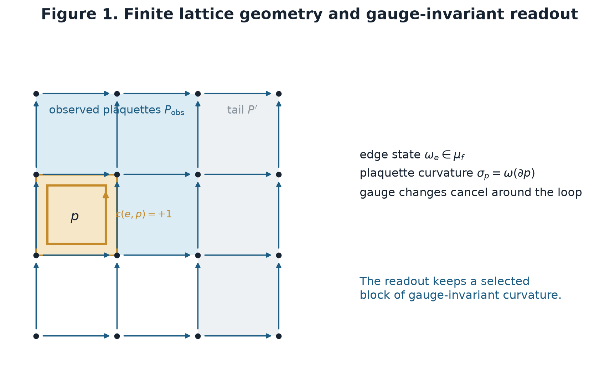
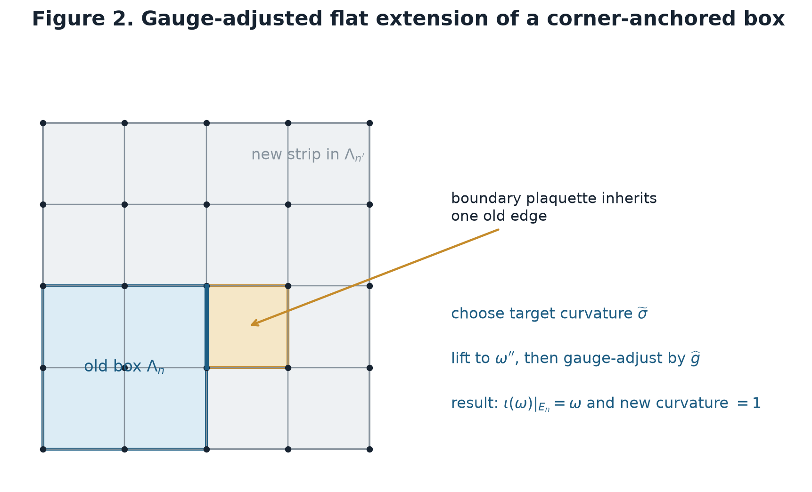
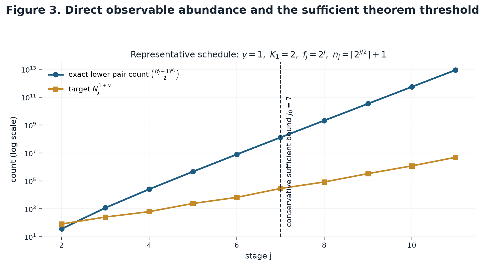

\begin{center}

{\LARGE\bfseries A Constructive Coherence-Tower Theorem for a U(1) Lattice Toy Model of Super Information Theory\par}

\vspace{0.35em}

{\large\itshape Finite Zf Gauge Data Embedded in U(1), Exact Orbit Counting, and Direct Observable Abundance\par}

\vspace{0.8em}

{\small\textbf{Author: Micah Blumberg}\par}

{\small Self Aware Networks Research Institute\par}

{\small\url{https://selfawarenetworks.com}\par}

{\small November 20, 2026 (Version 2 Successor Candidate to DOI 10.5281/zenodo.21693908)\par}

\end{center}

\vspace{0.65em}

MICHAHABSTRACTOPENMARKER

Can a large hidden configuration space survive a gauge collapse and still yield more than linearly many distinguishable observable relations? This paper answers that consistency question in one exact finite construction. Edge variables take values in the finite subgroup `μ_f ≅ Z_f ⊂ U(1)` on a two-dimensional box; gauge-equivalent edge assignments collapse to the same plaquette curvatures; excitation-count windows select admissible curvatures; and a restricted plaquette readout supplies observable values. Lemma 1 classifies the gauge orbits exactly. Theorems 2-8 prove the seven interface properties called a coherence tower in the SIT formal program. Theorem 10 then gives an explicit box-and-alphabet schedule and a closed-form threshold after which the number of unordered translated, Hamming-distinguishable observable pairs exceeds `N_j^{1+γ}` for any prescribed `γ > 0`. Theorem 11 assembles these results into the finite Toy SIT Theorem relative to the BC-004 interface definition. The result is an exact existence and realizability theorem for that finite interface. Extending it to the covariant full-SIT model, a nontrivial decoherence relation, continuous phase resolution, or empirical physics remains separate work.

MICHAHABSTRACTCLOSEMARKER

# Scope and evidence boundary

**Mathematical development assistance:** Claude (Anthropic), Branch C proof program, 2026-06-12
**Prior public versions:** Version 1 (June 12, 2026, Zenodo DOI 10.5281/zenodo.21231875) and Version 2 public house-style release (July 29, 2026, Paper 033, Zenodo DOI 10.5281/zenodo.21693908, https://pub.svgn.io/papers/paper-33/). This November 20, 2026 successor candidate corrects the Theorem 6 schedule-divisibility summary and two fibre-multiplicity wording errors (Remark RD3.1 and Theorem 10 Step 3), proves two bounded new mathematical results (Theorems 12 and 13 on the SU(2) Weyl-conjugation gauge-quotient obstruction and finite measurement-resolution capacity bounds), and adds an explicit interface crosswalk to the November 2026 four-dimensional periodic SU(2) lattice model (Model L3 in the separate SIT Version 81 monograph series).
**Copyright and license:** Copyright © 2011-2026 Micah Blumberg. Licensed under the Creative Commons Attribution 4.0 International License (CC BY 4.0). **Claim boundary:** Final-preprint successor with complete proofs for the specified finite toy model, clean computational replay, source-role audit, and release validation. The lift from this model to the covariant field theory of SIT remains an open obligation. The paper makes no claim to prove the Riemann Hypothesis. **Evidence-class convention.** Every substantive claim in this paper carries one of three labels. **[PROVED]**: established by a self-contained proof in this document. **[COMPUTATIONALLY CHECKED]**: replayed by the finite checker identified in §9, without replacing the proof. **[OPEN / CONJECTURAL]**: stated as an obligation or conjecture, with no proof claimed. No claim in this paper is of empirical ("measured") class; the model is a mathematical construction and no experiment is reported.

# 1. Introduction

## 1.1 Motivation

Super Information Theory (SIT) is a proposed physical theory in which observable structure arises by projection from a larger hidden configuration space carrying coherence relations. Its central mathematical claim  -  extracted and formalized by the SIT proof program  -  is a *mechanism* claim: hidden branch abundance survives a gauge-type collapse and projects to an *observable* family of values that is (i) superlinearly abundant relative to the size of the underlying discrete net, (ii) pairwise related by coordinatewise unit-modulus translations, and (iii) operationally distinguishable. Whether this mechanism can operate at all  -  whether the conjunction of requirements is even consistent  -  is a mathematical question independent of the physical truth of SIT.

This paper answers that consistency question affirmatively and constructively. Following the standard methodology of mathematical physics, in which lattice and toy models precede continuum results (Wilson 1974; Montvay-Münster 1994; Seiler 1982), we exhibit a fully specified finite model in which every requirement is a theorem with exact constants. The strength of the conclusion is exactly this and no more: the SIT mechanism is *realizable in a specified model*. Realizability in a toy model neither confirms nor disconfirms SIT as physics (§7).

## 1.2 The operation before the name

The unexplained problem can be stated without specialized SIT vocabulary. A lattice can contain many edge assignments, but many of them differ only by local gauge choice. After those redundancies are removed, the remaining states must still be numerous. A smaller readout must then preserve enough of their differences to produce a growing family of distinct outputs. Finally, the construction must survive when both the lattice and its finite phase alphabet are enlarged.

The established mathematical account supplies the raw materials: finite abelian lattice gauge variables, gauge orbits, plaquette holonomy, cycle-space counting, and a Wilson-type action. The proposed operation is then:

1. assign a root of unity to every oriented edge;
2. multiply the edge values around each plaquette to obtain gauge-invariant curvature;
3. identify edge assignments that differ only by a vertex gauge transformation;
4. retain curvatures inside explicit excitation-count windows;
5. read a fixed observed set of plaquettes;
6. enlarge the alphabet and box through injections that preserve the old curvature data; and
7. count the distinct observable relations that remain.

Only after this operation is explicit do we use the program name **coherence tower** for the family that satisfies the seven interface slots. The discriminating failure conditions are equally concrete: additional decoherence may merge orbits, continuous phase resolution may merge readout values, Bianchi constraints alter higher-dimensional curvature data, or no full-SIT lift may preserve the finite constants.

## 1.3 Main results

The program (BC-001, BC-004) reduced the mechanism claim to a conditional **Projection Theorem** consuming a definition of *admissible coherence data*, plus an open **Coherence Tower Lemma**: the construction of an infinite admissible family from a specified model. Our results:

- **Model specification (T0). [PROVED]** `M_toy` is specified exactly in §4: `μ_f`-valued lattice gauge configurations on the `n × n` box in `Z²`, gauge group acting by coboundary, Wilson plaquette action, excitation-count windows `(P_obs, K₁, K₂)`, and plaquette-holonomy readout. Lemma 1 classifies gauge orbits exactly: orbits are in bijection with curvature values, the orbit space is the full product `(μ_f)^{P_n}`, and every orbit has size `f^{|V_n|-1}`.
- **Coherence tower (Theorems 2-8, §5). [PROVED]** All seven sublemmas of the Coherence Tower Lemma hold for `M_toy`, each with exact (non-asymptotic) constants: surplus `f^{(n-1)²}` orbits; a discrete net with uniform separation / covering constants `(1, √2/2)`; unit translations realized by a free transitive group action; an exact window-orbit product formula; refinement maps for growing mode *and* growing box; exactly uniform readout fibres (equal orbit-level fibre cardinality `|T(P′, K₂)| = Σ_{k=0}^{min(K₂,|P′|)} C(|P′|, k)(f-1)^k` over every attained observable value, hence multiplicity ratio `m = 1`, not fibre cardinality `1`); and a constants table certifying infinite extension.
- **Direct abundance (Theorem 10, §6). [PROVED]** For every `γ > 0`, on the explicit schedule `n_j = ⌈2^{j/2}⌉ + 1`, `f_j = 2^j` with `K₁ = ⌈(1+γ)/2⌉ + 1`, the unit-coherence abundance satisfies `C_j ≥ N_j^{1+γ}` for all `j ≥ j₀(γ, K₁) = max(2, ⌈log₂ K₁⌉ + 1, ⌈K₁ + 1 + (1+γ)·log₂ 3⌉)`. This proves the abundance conclusion unconditionally, without routing through the conditional Projection Theorem.
- **Toy SIT Theorem (Theorem 11). [PROVED, relative to the BC-004 slot definition]** The above assemble into the program's constructive-toy milestone ("T3" in the T0-T4 ladder defined in the SIT Formal Proof Research Program of 2026-05-22 and used across the Branch C packets; the unconditional form is BC-006/C-19, which discharges the conditional BC-004/C-17 as unnecessary), with an interface table mapping each theorem to the admissible-coherence-data slot it discharges. The slot definition itself is external input (BC-004); Theorem 11 is proved relative to it.

What is **not** proved here  -  the specification of the covariant model `M_SIT` and the lift theorem (T4)  -  is stated as a set of precisely posed open problems in §8. **[OPEN / CONJECTURAL]**

## 1.4 Roadmap

§2 places the paper relative to known results and the program documents. §3 fixes notation. §4 specifies `M_toy` and proves the orbit classification (Lemma 1). §5 proves the seven tower sublemmas (Theorems 2-8). §6 defines the abundance functional, assembles the tower (Theorem 9), proves direct abundance (Theorem 10), and states the Toy SIT Theorem (Theorem 11) with its interface table. §7 delimits what is and is not established, including the limitations of the toy model. §8 states the open problems. §9 records reproducibility, provenance, and the deterministic finite replay.

*Figure 1.* States assign `μ_f` values to oriented edges; plaquette curvature reads their signed boundary product. The window separately constrains the observed block `P_obs` and the complementary tail `P′`.

# 2. Related work and program context

The orbit structure of finite abelian (`Z_f`) lattice gauge theory on planar graphs is classical: the coboundary kernel / image counting underlying Lemma 1 is textbook algebraic graph theory (Biggs 1993), and Wilson's plaquette action and the lattice-before-continuum methodology go back to Wilson (1974); for general lattice gauge background see Montvay-Münster (1994) and Seiler (1982). None of the individual counting facts in §4-§5 is claimed as new.

The contribution of this paper is the *assembly*: the coherence-tower interface (the seven-sublemma statement shape consumed by the SIT Projection Theorem, per the obligation ledger `sit-projection-kernel-obligations-20260602.csv` and packet BC-004), the exact window combinatorics of Theorem 5(b), the exactly-uniform-fibre readout of Theorem 7, the corrected flat box-extension construction of Theorem 6(b) (which repairs a gap in the naive "extend by 1" prescription), and the direct abundance theorem with explicit threshold (Theorem 10, sourced from packet BC-006's Theorem C-18; the unconditional Toy SIT Theorem assembled here is BC-006's C-19, which discharges the earlier conditional BC-004/C-17  -  conditional on the Branch A Projection-Theorem statement artifact "BC-A1"  -  as unnecessary).

Program context: the SIT Formal Proof Research Program of 2026-05-22 defines the T0-T4 theorem stack (T0 = model specification, T1 = conditional projection theorem, T2 = Coherence Tower Lemma, T3 = constructive toy theorem, T4 = full-SIT lift). Branch C packets BC-001…BC-010 and BC-014 record the later claim boundaries and gate history. The operator-theoretic HSIT-Riemann results are an independent companion deposit and are not used here.

## 2.1 Theorem-by-theorem citation roles

The proofs are self-contained; the literature supplies background, terminology, or program definitions rather than hidden proof steps. This distinction is important because a citation to standard context is not being used as a substitute for a theorem.

| Result or definition | External source role | Dependency boundary |
|---|---|---|
| Wilson action in D2.4 | Wilson (1974) supplies the original plaquette-action lineage | Definition-level background only; no theorem in this paper invokes a result from Wilson |
| Lemma 1 | Biggs (1993) supplies cycle-space, cut-space, and coboundary background | The kernel, image, exactness, and cardinality argument is proved in full here |
| Theorem 2 | Biggs (1993) supplies the connected-graph cycle-rank identity as standard background | The orbit count follows directly from Lemma 1 and the displayed Euler identity |
| Theorems 3-8 | No external theorem is imported | Each proof is written in this manuscript; Theorems 5-7 depend only on earlier internal definitions and results |
| Theorem 9 | BC-004 supplies the names and slots of the admissible-data interface | The finite construction is proved here; the interface definition is the only external input |
| Theorem 10 | BC-006 records the program provenance of the direct-abundance route | The schedule, lower bound, and threshold are rederived line-by-line here |
| Theorem 11 | BC-004 defines the interface and BC-006 records C-19 | The theorem is explicitly relative to that interface; it does not import a full-SIT lift |
| Full-SIT target | SIT v79 identifies the intended physical theory | It is an open comparison target, not evidence for any finite theorem |
| Lattice and constructive context | Montvay-Münster (1994) and Seiler (1982) provide field-level background | Context only; neither book is used as an unstated premise |
| HSIT-Riemann companion | Zenodo record 21231873 preserves cross-paper identity | Independent and unused in every proof here |

# 3. Notation

Throughout: `n, n′, f, f′, j` denote positive integers, and the excitation budgets `K₁, K₂` are non-negative integers (`K₁, K₂ ∈ Z_{≥0}`); `μ_f = {z ∈ C : z^f = 1}` is the cyclic group of `f`-th roots of unity (any `f ≥ 2`, prime or composite). Thus `μ_f ≅ Z_f` is a finite subgroup of `U(1)`; it is not the quotient group `U(1)/Z_f`. Also, `C(m, k)` is the binomial coefficient; `d_H` is the Hamming metric on tuple spaces `(μ_f)^S` (number of coordinates in which two tuples differ); `exc(τ)` for a tuple `τ ∈ (μ_f)^S` is the number of coordinates with `τ_s ≠ 1`. For a finite set `S`, `|S|` is its cardinality. All groups appearing are finite abelian, written multiplicatively. Labels: Lemma 1, Theorems 2-11, Definitions D1-D3, Remarks numbered by parent item (R1.1 under Lemma 1, R2.1 under Theorem 2, R3.1 under Theorem 3, R7.1 under Theorem 7, RD3.1 under Definition D3, R9.1 under Theorem 9).

# 4. The model `M_toy`

**Definition D1 (geometry and conventions).**
1. **Geometry.** `Λ_n` is the `n × n` box graph in `Z²` (`n ≥ 2`): vertex set `V_n = {0, …, n-1}²`, edge set `E_n` = nearest-neighbor pairs, plaquette set `P_n` = unit square faces. Then `|V_n| = n²`, `|E_n| = 2n(n-1)`, `|P_n| = (n-1)²`; `Λ_n` is connected, planar, simply connected, and satisfies the Euler relation `|E_n| = |V_n| - 1 + |P_n|` (check: `2n(n-1) = n² - 1 + (n-1)²`).
2. **Orientation conventions.** Each edge is oriented by the fixed lexicographic rule: horizontal edges point in `+x`, vertical edges in `+y`; an edge `e` is the ordered pair `(u, v)` with `v - u ∈ {(1,0), (0,1)}`. Each plaquette `p` carries the counterclockwise boundary orientation; for `ω : E_n → μ_f`,

   `ω(∂p) := ∏_{e ∈ ∂p} ω_e^{ε(e,p)}`, `ε(e,p) = +1` if `∂p` traverses `e` with its orientation, `-1` against it. **[1]**

   All counts and statements below are independent of these convention choices: reversing the orientation of an edge `e` replaces `ω_e` by `ω_e^{-1}` in every formula simultaneously, an automorphism of all the structures involved.

**Definition D2 (states, gauge, curvature, window, readout).**
1. **Mode ladder.** `f_j = 2^j` for `j ≥ 1`; since `f_j | f_{j+1}`, the alphabets are nested: `μ_{f_j} ⊂ μ_{f_{j+1}}`.
2. **Hidden states.** `Ω_f(Λ_n) = (μ_f)^{E_n}`; at stage `j`, `Ω_j(Λ_n) := Ω_{f_j}(Λ_n)`.
3. **Gauge group and action.** `G_f(Λ_n) = (μ_f)^{V_n}` acts by coboundary: for `e = (u, v)`, `(g·ω)_e = g_u ω_e g_v^{-1}`. **Decoherence equivalence:** declared trivial for `M_toy`  -  two states are equivalent iff gauge related. This is a conservative modeling choice in the following precise sense: each tower sublemma below asserts the existence or abundance of structure at the orbit level, and passing to a coarser equivalence can only merge orbits and thereby weaken or destroy such structure  -  it cannot create it. The gauge-only case is therefore the base case for the lift obligation of §8 (the candidate non-trivial decoherence relation for `M_SIT` is recorded in BC-014).
4. **Curvature.** `σ_p(ω) = ω(∂p)`; `σ(ω) = (σ_p(ω))_{p ∈ P_n} ∈ (μ_f)^{P_n}`. The Wilson-type plaquette action is

   `H(ω) = Σ_{p ∈ P_n} (1 - Re σ_p(ω)) ≥ 0`. **[2]**

   Wilson (1974) is the historical source for the plaquette-action lineage; no result from that paper is invoked in the proofs below.
5. **Window.** The triple `(P_obs, K₁, K₂)`  -  a subset `P_obs ⊆ P_n` of observed plaquettes and excitation budgets `K₁, K₂ ∈ Z_{≥0}`  -  consists of free finite parameters of the model family, fixed per schedule (Theorem 10 requires `|P_obs| ≥ K₁`). Writing `P′ = P_n ∖ P_obs`,

   `W = W(n, f, P_obs, K₁, K₂) = {ω ∈ Ω_f(Λ_n) : exc(σ(ω)|_{P_obs}) ≤ K₁ and exc(σ(ω)|_{P′}) ≤ K₂}`. **[3]**

6. **Readout.** `π_obs(ω) = σ(ω)|_{P_obs} ∈ (μ_f)^{P_obs}`; gauge invariant since `σ` is (Lemma 1).

**Lemma 1 (orbit classification). [PROVED]** *Let `n ≥ 2` and `f ≥ 2` (prime or composite). On `Λ_n` with alphabet `μ_f`:*
*(i) `σ` is gauge invariant;*
*(ii) two states are gauge related if and only if they have the same curvature, so `σ` classifies gauge orbits exactly;*
*(iii) `σ : Ω_f(Λ_n) → (μ_f)^{P_n}` is surjective, so the orbit space is all of `(μ_f)^{P_n}`;*
*(iv) every gauge orbit has size exactly `f^{|V_n|-1}`.*

*Proof.* Let `δ : (μ_f)^{V_n} → (μ_f)^{E_n}`, `(δg)_e = g_u g_v^{-1}` for `e = (u, v)`, the coboundary homomorphism of finite abelian groups; the gauge action of `g` on `ω` is coordinatewise multiplication by `δg`, i.e. the orbits are the cosets of `im(δ)`.

*Kernel of `δ`.* `δg = 1` iff `g_u = g_v` for every edge `(u, v)`; since `Λ_n` is connected, this forces `g` constant, so `ker(δ) ≅ μ_f`, of order `f`. By the first isomorphism theorem, `|im(δ)| = f^{|V_n|}/f = f^{|V_n|-1}`. (No vector-space structure is used; the argument is valid verbatim for composite `f`.) This proves (iv): translation of a group on itself is free, so every coset of `im(δ)` has exactly `|im(δ)|` elements.

*Gauge invariance (i) and `im(δ) ⊆ ker(σ)`.* For a plaquette `p`, each vertex on `∂p` is the head of one traversed edge and the tail of the next; in the product `(δg)(∂p)` every `g_u` appears once with exponent `+1` and once with exponent `-1`, so `(δg)(∂p) = 1`. Hence `σ(g·ω) = σ(δg · ω) = σ(ω)`.

*`ker(σ) ⊆ im(δ)` (simple connectivity).* Suppose `σ(ω) = 1`, i.e. `ω(∂p) = 1` for every plaquette. Then `ω(c) = 1` for every cycle `c` of `Λ_n`: the cycle space of a planar graph is generated by its bounded face boundaries, and `Λ_n` is simply connected (no holes), so every cycle is a product of plaquette boundaries (Biggs 1993, cycle-space background). Fix a spanning tree `T` of `Λ_n` and a root vertex `r`; for `v ∈ V_n` define `g_v = ω(path_T(r → v))`, the ordered product of `ω_e^{ε}` along the tree path with `ε = +1` when the path traverses `e` with its orientation and `-1` against it. For any edge `e = (u, v)` (oriented `u → v`), the closed walk `path_T(r → u)`, then `e`, then `path_T(v → r)` is a cycle of `Λ_n`, so its `ω`-holonomy is `1`: `g_u · ω_e · g_v^{-1} = 1`, i.e. `ω_e = g_u^{-1} g_v = (δ(g^{-1}))_e`. Hence `ω = δ(g^{-1}) ∈ im(δ)`. Combining, `ker(σ) = im(δ)`, which with (i) proves (ii): `σ(ω) = σ(ω′)` iff `ω′ω^{-1} ∈ ker(σ) = im(δ)` iff `ω, ω′` are gauge related.

*Surjectivity (iii).* We have the exact sequence of finite abelian groups

`1 → μ_f → (μ_f)^{V_n} →^δ (μ_f)^{E_n} →^σ (μ_f)^{P_n}`. **[4]**

with `|im(σ)| = f^{|E_n|}/|ker(σ)| = f^{|E_n|}/f^{|V_n|-1} = f^{|E_n|-|V_n|+1} = f^{|P_n|}` by the Euler relation. Since `im(σ) ⊆ (μ_f)^{P_n}` and the two groups have equal order, `σ` is surjective, completing the exact sequence

`1 → μ_f → (μ_f)^{V_n} →^δ (μ_f)^{E_n} →^σ (μ_f)^{P_n} → 1`. **[5]** ∎

**Remark R1.1 (where simple connectivity is used).** Exactness of the four-term sequence at `(μ_f)^{E_n}` and surjectivity of `σ` use planarity and simple connectivity of `Λ_n` and are special to this `d = 2` setting; this is exactly the point at which the `d ≥ 3` situation differs (Remark R2.1). The kernel / image counting for the coboundary on a connected graph is classical algebraic graph theory (Biggs 1993); the proof above is kept self-contained.

# 5. The seven sublemmas (all proved)

All theorems in this section are of evidence class **[PROVED]**.

**Theorem 2 (Surplus).** *Let `n ≥ 2`, `f ≥ 2`. The number of gauge orbits in `Ω_f(Λ_n)` is exactly*

`#orbits = f^{|E_n|-|V_n|+1} = f^{cycle rank(Λ_n)} = f^{|P_n|} = f^{(n-1)²}`. **[6]**

*In particular, raw branch abundance (`f^{|E_n|}` states) survives gauge collapse (division by `f^{|V_n|-1}`) with an orbit count that is itself exponential in the area.*

*Proof.* By Lemma 1(iv) the translation action of `im(δ)` on `(μ_f)^{E_n}` is free, so the orbit count is `f^{|E_n|}/f^{|V_n|-1} = f^{|E_n|-|V_n|+1}`; and `|E_n| - |V_n| + 1 = |P_n| = (n-1)²` by the Euler relation. The identification `|E_n| - |V_n| + 1 = cycle rank` is the standard first-Betti-number formula for a connected graph (standard; Biggs 1993). ∎

**Remark R2.1 (higher-dimensional aside, quarantined; the asymptotics here are [PROVED] for the orbit count only).** In any dimension `d ≥ 2`, the orbit count is `f^{cycle rank}`  -  the free-translation argument of Theorem 2 is dimension-free  -  giving `f^{(d-1)n^d(1+o(1))}` on the `d`-dimensional box (cycle rank `= |E| - |V| + 1`). Relative to the raw edge-state exponent `|E| ∼ d n^d`, the retained exponent ratio tends to `(d-1)/d > 0`. However, the identification of the orbit *space* with the full product `(μ_f)^{P}` (Lemma 1(iii)) is special to the simply connected `d = 2` case: for `d ≥ 3`, plaquette holonomies satisfy Bianchi-type constraints around 3-cells, `σ` is not surjective onto the product, and the window product formula of Theorem 5 is not available. No statement outside this remark uses `d ≥ 3`; whether the full tower survives the Bianchi constraints is Open Problem OP3 (§8).

**Theorem 3 (Discrete Net).** *For every `n ≥ 2`, the configuration index set `Z² ∩ Λ_n` (the vertex net) is uniformly discrete with separation constant exactly `1` and relatively dense in the box with covering radius exactly `√2/2`; both constants are independent of `n`, `f`, and the stage `j`.*

*Proof.* Distinct points of `Z²` are at Euclidean distance `≥ 1`, attained by nearest neighbors. Every point of the solid box `[0, n-1]²` lies within distance `√2/2` of a lattice point (the worst case is the center of a unit cell), attained at cell centers. ∎

**Remark R3.1 (interface role).** Theorem 3 is elementary; its role is purely interfacial: it discharges the **discrete-net slot** (stage carrier) of the admissible-coherence-data definition consumed by the Projection Theorem (BC-004 slot families; obligation ledger `sit-projection-kernel-obligations-20260602.csv`), with the uniform constant pair `(separation, covering radius) = (1, √2/2)` recorded for all `(n, f, j)`. See the interface table after Theorem 11.

**Theorem 4 (Unit Translation).** *Let `n ≥ 2`, `f ≥ 2`, and fix a gauge class `O ⊆ Ω_f(Λ_n)`. The set of branch ratios `{ω′ω^{-1} : ω, ω′ ∈ O}` (coordinatewise quotient) is precisely the translation group `im(δ) ≤ (μ_f)^{E_n}`, of order `f^{|V_n|-1}`, acting freely and transitively on `O`. In particular every such ratio is a coordinatewise unit-modulus translation (an element of `(μ_f)^{E_n}`, all coordinates on the unit circle).*

*Proof.* By Lemma 1(ii), `ω, ω′` lie in the same class iff `ω′ω^{-1} ∈ im(δ)`; conversely each `t ∈ im(δ)` maps `O` to itself by translation. Freeness and transitivity are immediate for the translation action of a group on one of its cosets. Unit-modularity is automatic for root-of-unity alphabets  -  the content of the theorem is the group structure: the unit-translation slot is realized by a transitive structured family, not merely by pointwise unit numbers. ∎

**Theorem 5 (Stable Growth).** *Let `n ≥ 2`, `f ≥ 2`, `P_obs ⊆ P_n`, `P′ = P_n ∖ P_obs`, and `K₁, K₂ ≥ 0`.*

*(a) (Coercivity.) For every `ω ∈ Ω_f(Λ_n)`: `H(ω) ≥ κ_f · exc(σ(ω))`, with `κ_f = 1 - cos(2π/f) > 0`.* **[7]**

*(b) (Exact window count.) The number of gauge orbits meeting `W(n, f, P_obs, K₁, K₂)` is exactly*

`#orbits(W) = [Σ_{k=0}^{min(K₁,|P_obs|)} C(|P_obs|, k)(f-1)^k] · [Σ_{k=0}^{min(K₂,|P′|)} C(|P′|, k)(f-1)^k]`. **[8]**

*(c) (Growth envelope.) Consequently `#orbits(W)` is at most `(1+|P_obs|)(1+|P′|) · max_k C(|P_obs|,k) · max_k C(|P′|,k) · (f-1)^{K₁+K₂}`, and, provided `|P_obs| ≥ K₁` and `|P′| ≥ K₂` (so the top binomial terms are nonvanishing), at least `(f-1)^{K₁+K₂}`.*

*Proof.* (a) Each excited plaquette contributes `1 - Re σ_p ≥ 1 - cos(2π/f)`, because the nontrivial elements of `μ_f` nearest to `1` are `e^{±2πi/f}`; unexcited plaquettes contribute `0 ≥ 0`. Summing over plaquettes gives the bound.

(b) By Lemma 1(ii)-(iii), gauge orbits are in bijection with curvature values `σ ∈ (μ_f)^{P_n} = (μ_f)^{P_obs} × (μ_f)^{P′}`, and window membership is a condition on `σ` alone, factoring as (excitation of the `P_obs` block `≤ K₁`) × (excitation of the `P′` block `≤ K₂`). The number of tuples in `(μ_f)^m` with at most `K` nontrivial coordinates is `Σ_{k=0}^{min(K,m)} C(m, k)(f-1)^k` (choose the excited coordinates, then a nontrivial value for each). Multiplying the two independent factors gives the formula.

(c) Upper bound: bound every term of each sum by its largest factor combination. Lower bound: the single term `k = K₁` in the first factor and `k = K₂` in the second contribute `C(|P_obs|, K₁)(f-1)^{K₁} · C(|P′|, K₂)(f-1)^{K₂} ≥ (f-1)^{K₁+K₂}` when both binomials are `≥ 1`, i.e. when `|P_obs| ≥ K₁` and `|P′| ≥ K₂`. ∎

**Theorem 6 (Persistent Splitting).** *Along a schedule both the mode and the box may grow; both refinements preserve the tower structure:*

*(a) (Mode refinement, fixed box.) Let `f | f′` (in particular `f_j | f_{j+1}`). The coordinatewise inclusion `Ω_f(Λ_n) ↪ Ω_{f′}(Λ_n)` induced by `μ_f ⊂ μ_{f′}` is injective, gauge equivariant (with respect to `G_f ⊂ G_{f′}`), commutes with `σ`, preserves excitation counts and hence window membership (for the same `(P_obs, K₁, K₂)`), and carries distinct gauge orbits to distinct gauge orbits.*

*(b) (Box extension, fixed mode.) Let `2 ≤ n ≤ n′` and anchor `Λ_n` at the lower-left corner of `Λ_{n′}`, so that `V_n ⊆ V_{n′}`, `E_n ⊆ E_{n′}`, `P_n ⊆ P_{n′}`, and every plaquette of `Λ_n` has all four edges in `E_n`. There exists an injection `ι : Ω_f(Λ_n) ↪ Ω_f(Λ_{n′})` such that:*
  *(b1) `ι(ω)|_{E_n} = ω`;*
  *(b2) `σ_p(ι(ω)) = σ_p(ω)` for every `p ∈ P_n`, and `σ_p(ι(ω)) = 1` for every new plaquette `p ∈ P_{n′} ∖ P_n` (flat extension at the curvature level);*
  *(b3) for `P_obs ⊆ P_n` (kept inside the old box), `ι` preserves window membership for the same budgets `(K₁, K₂)`  -  the extension adds zero excitation;*
  *(b4) `ι` carries distinct gauge orbits of `Ω_f(Λ_n)` to distinct gauge orbits of `Ω_f(Λ_{n′})`.*

*Composites of (a) and (b) give the tower maps for any schedule $(n_j, f_j)$ satisfying $n_j \le n_{j+1}$ and $f_j \mid f_{j+1}$ (in particular for the powers-of-two schedule $f_j = 2^j$ of §6; mere monotonicity $f_j \le f_{j+1}$ without divisibility is insufficient because $\mu_2 \not\subset \mu_3$): holonomy channels survive refinement.*

*Figure 2.* The highlighted boundary plaquette inherits an old edge, so setting all new edges to one need not be flat. Theorem 6(b) instead fixes the target curvature, lifts it to the larger box, and gauge-adjusts the lift so that the old edge data are recovered exactly.

*Proof.* (a) Injectivity, equivariance, and commutation with `σ` are immediate from coordinatewise inclusion (the boundary products are computed in the larger group, where they agree). Excitation counts are preserved because `σ_p ≠ 1` is unchanged under inclusion. Orbit distinctness: by Lemma 1(ii) on each side, orbits are labeled by curvature, and the inclusion `(μ_f)^{P_n} ⊂ (μ_{f′})^{P_n}` is injective on labels.

(b) Define the target curvature `σ̃ ∈ (μ_f)^{P_{n′}}` by `σ̃_p = σ_p(ω)` for `p ∈ P_n` and `σ̃_p = 1` for new `p`. By Lemma 1(iii) on `Λ_{n′}` choose `ω″ ∈ Ω_f(Λ_{n′})` with `σ(ω″) = σ̃`. The restriction `ω″|_{E_n}` is a configuration on `Λ_n` whose curvature equals `σ(ω)` (every old plaquette has all edges old, so its holonomy is computed within `E_n`); by Lemma 1(ii) on `Λ_n` there is `g ∈ (μ_f)^{V_n}` with `g·(ω″|_{E_n}) = ω`. Extend `g` to `ĝ ∈ (μ_f)^{V_{n′}}` by `ĝ_v = 1` for new vertices `v`, and set `ι(ω) := ĝ·ω″`. Then: (b1) holds because on old edges `ĝ` acts exactly as `g` (both endpoints of an old edge are old vertices); (b2) holds because gauge action preserves curvature, so `σ(ι(ω)) = σ(ω″) = σ̃`; (b3) holds because the observed-block and tail-block excitations of `σ̃` equal those of `σ(ω)` (new plaquettes contribute zero excitation and `P_obs ⊆ P_n`); (b4) holds because `σ̃` determines `σ(ω)` by restriction to `P_n`, and curvature labels orbits on both boxes (Lemma 1(ii)).

Injectivity of `ι`: restriction to `E_n` is a left inverse by (b1). (Note: `ι` is a well-defined injection for any fixed choice function in the two choice steps above; distinct choices yield maps differing by a gauge transformation fixing `E_n` pointwise, and all conclusions (b1)-(b4) are independent of the choice.)

*Caution (recorded for referees).* The naive prescription "extend by `ω ≡ 1` on new edges" does **not** in general satisfy (b2): a new boundary-strip plaquette can have one old edge carrying a nontrivial value and three new edges, giving holonomy `≠ 1`. The gauge-adjusted construction above is the correct flat extension; alternatively one may solve for new-edge values plaquette-by-plaquette along the added strips (each new plaquette in a sweep order contains a fresh new edge; the count `|E_{n′}| - |E_n| = (|V_{n′}| - |V_n|) + (|P_{n′}| - |P_n|)`, from the Euler relations of both boxes, shows the system is exactly solvable after fixing a spanning-tree extension). ∎

**Theorem 7 (Projection Complexity).** *Let `n ≥ 2`, `f ≥ 2`, `P_obs ⊆ P_n`, `P′ = P_n ∖ P_obs`, `K₁, K₂ ≥ 0`. Identify gauge orbits with curvature values (Lemma 1). Then:*

*(a) (Exactly uniform fibres.) For every observable value `y ∈ (μ_f)^{P_obs}` with `exc(y) ≤ K₁`, `y` is attained on the window, and the fibre of the orbit-level readout over `y` is the **full** admissible tail set `{τ ∈ (μ_f)^{P′} : exc(τ) ≤ K₂}`  -  the same set for every such `y`. In particular the multiplicity ratio between any two attained values is exactly `m = 1`.*

*(b) (Separation.) Distinct observable values are at Hamming distance `≥ 1` in `(μ_f)^{P_obs}`, a distinguishability scale independent of `f, n, j`.*

*Proof.* (a) By Lemma 1(iii) the orbit space is the full product `(μ_f)^{P_obs} × (μ_f)^{P′}`, and window membership factors as a product condition (Theorem 5(b)); therefore the set of admissible tails over `y` is `{τ : exc(τ) ≤ K₂}` whenever `exc(y) ≤ K₁`, independent of `y`. Every such `y` is attained: pair it with the flat tail `τ ≡ 1` (admissible since `exc ≤ K₂` holds with `0`). (b) Distinct tuples differ in at least one coordinate. ∎

**Remark R7.1 (why the Hamming metric).** Hamming separation is the exact operational notion of distinguishability for the count-based readout used here: `π_obs` reports the holonomy tuple itself, and the window is defined by excitation *counts*, so two observable values are distinguishable iff they differ in some coordinate  -  regardless of how metrically close adjacent roots of unity become in `C` as `f → ∞`. Phase-resolution-limited readout, under which adjacent roots of unity at large `f` would merge, is a property of `M_SIT`-type models with continuous observables; it is absent from `M_toy` by construction and is Open Problem OP5 (§8).

**Theorem 8 (Infinite Extension).** *Every quantity appearing in Theorems 2-7 is either stage-independent or given by an explicit closed-form function of `(f_j, n_j)` and the fixed window parameters, as tabulated below. The genuinely uniform interface constants are the net separation, covering radius, fibre-multiplicity ratio, and Hamming separation. The family `{(Ω_j(Λ_{n_j}), G_j, σ, W, π_obs)}_{j ≥ 1}` therefore extends to `j → ∞` with explicit stage controls. The single degrading quantity, the coercivity constant `κ_{f_j} = 1 - cos(2π/f_j) → 0`, is quarantined: no statement in §6 uses a lower bound on `H`  -  the windows are stated directly in excitation counts, which are `f`-independent.*

*Proof.* By inspection of the table; each row cites the theorem where the value is computed. The quarantine claim is verified by inspection of §6: Theorems 9-11 invoke only Lemma 1 and Theorems 2, 5(b), 6, 7, none of which uses Theorem 5(a)'s coercivity bound. ∎

*Constants table.*

| Quantity | Value | Source | Dependence | Status |
|---|---|---|---|---|
| Orbit size | `f^{|V_n|-1} = f^{n²-1}` | Lemma 1(iv) | closed form in `(n, f)` | exact, monotone |
| Orbit count | `f^{(n-1)²}` | Thm 2 | closed form in `(n, f)` | exact, monotone |
| Net separation / covering radius | `1` / `√2/2` | Thm 3 | none | uniform |
| Unit-translation group order | `f^{n²-1}` | Thm 4 | closed form | exact, monotone |
| Window orbit count | product formula | Thm 5(b) | closed form in `(n, f, |P_obs|, K₁, K₂)` | exact |
| Coercivity `κ_f` | `1 - cos(2π/f)` | Thm 5(a) | `f` only | degrading, quarantined |
| Fibre multiplicity ratio `m` | `1` | Thm 7(a) | none | exact, uniform |
| Hamming separation | `1` | Thm 7(b) | none | uniform |

# 6. The tower and the abundance theorem

All theorems in this section are of evidence class **[PROVED]** (Theorem 11 relative to the BC-004 slot definition, as noted).

**Definition D3 (observable value set, abundance functional, net size; definition imported from BC-006, threshold and unordered-pair count made explicit here).** Fix a schedule `(n_j, f_j)` and window parameters `(P_obs, K₁, K₂)` as in D2.5. Let

`Y_j = π_obs(W(n_j, f_j, P_obs, K₁, K₂)) ⊆ (μ_{f_j})^{P_obs}`. **[9]**

be the set of attained observable values at stage `j`. The **unit-coherence abundance** is

`C_j = #{ {y, y′} ⊆ Y_j : y ≠ y′; y′ = t·y coordinatewise for some t ∈ (μ_{f_j})^{P_obs}; d_H(y, y′) ≥ 1 }`. **[10]**

the number of unordered pairs of distinct attained observable values related by a coordinatewise unit-modulus translation and Hamming-separated. The **net size** is `N_j = |V_{n_j}| = n_j²`. **[11]**

**Remark RD3.1 (scope of the definition, and why pairs).** Two disclosures. *(1) In `M_toy` the side conditions are automatic:* for root-of-unity alphabets, any two distinct tuples satisfy both the translation condition (set `t = y′y^{-1}`) and `d_H ≥ 1`, so here `C_j = C(|Y_j|, 2)` exactly. The conditions are retained in the definition because they are the Projection Theorem's interface conditions (BC-006), and they are *not* automatic in continuous-alphabet models such as the intended `M_SIT`, where the same functional will be evaluated; the toy result is that `Y_j` is large and every attained value has identical orbit-level fibre cardinality `|T(P′, K₂)|` so the multiplicity *ratio* between any two fibres is exactly `m = 1` (Theorem 7(a))  -  not that each fibre is a singleton of size `1` (nor that the side conditions do work here). **Correction note (November 2026):** Earlier editions inadvertently wrote "fibre multiplicity exactly 1" here and in Theorem 10 Step 3. In fact, on the `3 × 3` vertex box `Λ₃` (`|P₃| = 4` plaquettes) with `f = 2`, `|P_obs| = 1`, `K₁ = 1`, and `K₂ = 1`, the three unobserved plaquettes admit four distinct tails (`(1,1,1), (1,1,-1), (1,-1,1), (-1,1,1)`, or `000, 001, 010, 100` in additive `Z₂` notation), so each attained readout has orbit-level fibre cardinality `4` (and `4 × 2^8 = 1,024` edge configurations), while the ratio of fibre sizes is `4/4 = 1`. Because `C_j` counts unordered pairs of distinct attained readouts in `Y_j`, this correction does not affect Theorem 10. *(2) Why pairs rather than `|Y_j|`:* the Projection Theorem's conclusion quantifies unit-translated *relations* between observables, so unordered pairs are its natural count (obligation ledger `sit-projection-kernel-obligations-20260602.csv`). The result is robust to this choice: on the Theorem 10 schedule, `|Y_j| ≥ (f_j-1)^{K₁}` already exceeds `N_j^{K₁-ε}` for every `ε > 0` and large `j`, which is superlinear once `K₁ ≥ 2`; pair-counting strengthens, not gerrymanders, the exponent.

**Theorem 9 (Toy Coherence Tower).** *`M_toy` generates an infinite family of admissible coherence data with the properties of Theorems 2-8  -  this is the statement shape (the Coherence Tower Lemma instance) consumed by the program's conditional Projection Theorem, with "admissible" meaning: each slot of the BC-004 admissible-coherence-data definition is discharged by the theorem listed in the interface table after Theorem 11. Moreover, for every `γ > 0`, on any schedule `(n_j, f_j)` with `n_j → ∞` and `f_j ≥ 2`, the hidden-orbit abundance `f_j^{(n_j-1)²}` exceeds `N_j^{1+γ}` for every `j` such that `2^{(n_j-1)²} ≥ n_j^{2(1+γ)}`  -  in particular for all `j` with `n_j ≥ n*(γ)`, where `n*(γ)` is the least `n` with `(n-1)² ≥ 2(1+γ)·log₂ n` (e.g. `n*(γ) ≤ 5` for all `γ ≤ 2`).*

*Proof.* The family is assembled from Theorems 2-8: schedule steps that refine the mode use the maps of Theorem 6(a); steps that grow the box use the box-extension maps of Theorem 6(b); composites handle simultaneous growth. For the hidden-side abundance, by Theorem 2 the orbit count at stage `j` is `f_j^{(n_j-1)²} ≥ 2^{(n_j-1)²}`, while `N_j^{1+γ} = n_j^{2(1+γ)}`; the displayed condition is exactly `2^{(n_j-1)²} ≥ n_j^{2(1+γ)}`, equivalently `(n_j-1)² ≥ 2(1+γ)·log₂ n_j`. The ratio `q(x) = (x-1)²/ln x` is strictly increasing for `x ≥ 2`: its derivative has the sign of `2 ln x - 1 + 1/x`, which is positive at `x = 2` and has derivative `(2x-1)/x² > 0`. Hence the inequality holds for every `n_j ≥ n*(γ)`, with `n*(γ)` finite. For the parenthetical bound: at `n = 5` and `γ ≤ 2`, `(n-1)² = 16 ≥ 2(1+γ)·log₂ 5`, since `2(1+γ)·log₂ 5 ≤ 6·log₂ 5 < 6 · 2.33 < 14 < 16`; hence `n*(γ) ≤ 5` for all `γ ≤ 2`. ∎

**Remark R9.1.** Theorem 9 is the interface-shaped statement; the hidden-side abundance claim is easy by design (it concerns orbit counts, not observables). The substantive quantitative result is Theorem 10, which proves abundance for the *observable* projection directly, bypassing the conditional route entirely.

**Theorem 10 (Direct projection abundance).** *Fix `γ > 0`. Choose:*
- *`K₁ = ⌈(1+γ)/2⌉ + 1` (any larger `K₁` also works);*
- *any `K₂ ≥ 0` (the conclusion is uniform in `K₂`);*
- *`P_obs` with `|P_obs| ≥ K₁`, fixed inside the box `Λ_{n_{j₁}}` at the stage `j₁ := max(2, ⌈log₂ K₁⌉ + 1)` (at which `|P_{n_{j₁}}| = (n_{j₁}-1)² ≥ 2^{j₁} ≥ K₁`, so such a `P_obs` exists), and kept inside all later boxes via the corner anchoring of Theorem 6(b);*
- *the schedule `n_j = ⌈2^{j/2}⌉ + 1`, `f_j = 2^j`.*

*Then the unit-coherence abundance of Definition D3 satisfies*

`C_j ≥ N_j^{1+γ}` *for all* `j ≥ j₀(γ, K₁) := max( j₁, ⌈K₁ + 1 + (1+γ)·log₂ 3⌉ )`. **[12]**

*Figure 3.* For the representative case `γ = 1`, `K₁ = 2`, the exact pair-count lower bound already exceeds the target before the conservative closed-form threshold. Theorem 10 guarantees the inequality for every stage at or beyond `j₀`; it does not claim that `j₀` is the earliest crossing.

*Proof.* **Step 0 (window placement).** Since `(n_j - 1)² ≥ 2^j` (Step 1 below) and `2^{j₁} ≥ 2^{⌈log₂ K₁⌉} ≥ K₁`, the box at stage `j₁` has at least `K₁` plaquettes, so a `P_obs` with `|P_obs| ≥ K₁` exists inside `Λ_{n_{j₁}}`; corner anchoring (Theorem 6(b)) keeps `P_obs ⊆ P_{n_j}` for all `j ≥ j₁`. All subsequent steps are for `j ≥ j₁`.

**Step 1 (schedule constants).** From `n_j = ⌈2^{j/2}⌉ + 1`: `2^{j/2} ≤ n_j - 1 ≤ 2^{j/2} + 1`, so

`f_j = 2^j ≤ (n_j - 1)² < N_j = n_j² ≤ (2^{j/2} + 2)² = 2^j + 4·2^{j/2} + 4 ≤ 9·2^j = 9 f_j` for all `j ≥ 1`. **[13]**

Thus `f_j ≤ N_j ≤ 9 f_j` (two-sided comparison with explicit constants `1` and `9`).

**Step 2 (attainment: lower bound on `|Y_j|`).** Fix a subset `S ⊆ P_obs` with `|S| = K₁` (possible since `|P_obs| ≥ K₁`). For every tuple `y ∈ (μ_{f_j})^{P_obs}` supported on `S` (i.e. `y_p = 1` off `S`) with all `K₁` entries on `S` nontrivial, we have `exc(y) = K₁ ≤ K₁`, and `y` is attained: by Lemma 1(iii) and Theorem 5(b)'s product structure, pair `y` with the flat tail `τ ≡ 1` on `P′` (admissible since `exc(τ) = 0 ≤ K₂`, for any `K₂ ≥ 0`). There are `(f_j - 1)^{K₁}` such tuples, so

`|Y_j| ≥ (f_j - 1)^{K₁}`. **[14]**

**Step 3 (structure of pairs).** Every unordered pair of distinct values in `Y_j` satisfies the conditions of Definition D3: the ratio `t = y′y^{-1} ∈ (μ_{f_j})^{P_obs}` is a coordinatewise unit-modulus translation, and `d_H(y, y′) ≥ 1` (Theorem 7(b)); every attained value in `Y_j` is realized with the same orbit-level fibre cardinality `|T(P′, K₂)|` (multiplicity ratio `m = 1`, Theorem 7(a)), and `C_j` counts distinct attained readouts in `Y_j` directly without conflating fibre ratio with singleton cardinality.

**Step 4 (counting with explicit constants).** For `|Y_j| ≥ 2` (which holds once `f_j ≥ 3`, i.e. `j ≥ 2`; and `j₁ ≥ 2` by definition):

`C_j = C(|Y_j|, 2) = |Y_j|(|Y_j|-1)/2 ≥ |Y_j|²/4 ≥ (f_j - 1)^{2K₁}/4 ≥ f_j^{2K₁}/(4·2^{2K₁})`. **[15]**

using `f_j - 1 ≥ f_j/2` for `f_j ≥ 2`. On the other side, by Step 1, `N_j^{1+γ} ≤ (9 f_j)^{1+γ} = 9^{1+γ} f_j^{1+γ}`. Hence `C_j ≥ N_j^{1+γ}` holds provided

`f_j^{2K₁ - 1 - γ} ≥ 2^{2K₁+2} · 9^{1+γ}`. **[16]**

Since `K₁ ≥ ⌈(1+γ)/2⌉ + 1` gives `2K₁ ≥ (1+γ) + 2`, the exponent satisfies `2K₁ - 1 - γ ≥ 2`, so it suffices that `f_j² ≥ 2^{2K₁+2} · 9^{1+γ}`, i.e. `2j ≥ 2K₁ + 2 + (1+γ)·log₂ 9`, i.e. `j ≥ K₁ + 1 + (1+γ)·log₂ 3`. Combining with the `j ≥ j₁` requirement of Step 0 yields the stated `j₀(γ, K₁)`. ∎

**Theorem 11 (Toy SIT Theorem).** *The specified model `M_toy` (Definitions D1-D2) satisfies both the Coherence Tower (Theorem 9) and the superlinear observable unit-coherence abundance conclusion (Theorem 10), by self-contained proofs using no full-SIT language and no numerical input; the discharge of each slot of the admissible-coherence-data definition (external input: BC-004) is itemized line-by-line in the interface table below, against the obligation ledger `sit-projection-kernel-obligations-20260602.csv`. This is the unconditional Toy SIT Theorem of packet BC-006 (C-19), which supersedes the conditional BC-004/C-17.* ∎

*Interface table (sublemma → admissible-coherence-data slot; BC-004 slot families).*

| Theorem | Slot discharged | Constants supplied |
|---|---|---|
| Thm 3 | Discrete net (stage carrier) | separation 1, covering radius `√2/2`, uniform in `(n, f, j)` |
| Thm 2 | Surplus (retained sector) | orbit count `f^{(n-1)²}` exact |
| Thm 4 | Unit translation (unit holonomy) | group `im(δ)`, order `f^{n²-1}`, free + transitive |
| Thm 5 | Stable growth (admissibility) | exact product formula; coercivity `κ_f = 1 - cos(2π/f)` |
| Thm 6 | Persistent splitting (cross-scale / refinement) | mode map (a) + box map (b), both injective, curvature- and window-preserving |
| Thm 7 | Projection complexity (readout) | multiplicity ratio `m = 1` exact (uniform fibre cardinality `|T(P′, K₂)|`); Hamming separation 1 |
| Thm 8 | Infinite extension | constants table of §5; `κ_f` quarantine verified |

# 6.5 New bounded theorems: SU(2) gauge-quotient obstruction and finite measurement resolution (November 2026)

To connect the finite abelian toy construction cleanly to both non-abelian lattice extensions and operational measurement limits, we prove two new self-contained theorems. Both are verified independently by exact matrix arithmetic, enumeration, and counterexample checks in `verify_paper033_v2.py` (§9).

**Theorem 12 (Global SU(2) Weyl-conjugation quotient obstruction). [PROVED]** *Let `n ≥ 2` and `f ≥ 3`, and define the diagonal group embedding `ι_diag : μ_f ↪ SU(2)` by `ι_diag(z) = diag(z, z^{-1})`, extended edgewise to `Ω_f(Λ_n) → SU(2)^{E_n}`. Then:*

*(a) (Stage 1: Irreversible global gauge-orbit collapse.) Under the constant `SU(2)` gauge transformation `W = iσ₂ = [[0, 1], [-1, 0]] ∈ SU(2)` applied uniformly at every vertex `v ∈ V_n`, every link transforms as `W diag(z, z^{-1}) W^{-1} = diag(z^{-1}, z)`, sending the entire plaquette curvature tuple `σ = (σ_p)_{p ∈ P_n}` to its conjugate inverse `σ^{-1} = (σ_p^{-1})_{p ∈ P_n}`. Consequently, every non-self-conjugate abelian curvature tuple (`σ ≠ σ^{-1}`) represents two distinct `U(1)` gauge orbits by Lemma 1 that map into the **same** `SU(2)` gauge orbit. The number of global Weyl-quotient classes in `(μ_f)^{P_n}/Z₂` is strictly smaller than `f^{(n-1)²}`:*

`#orbits_{Weyl}(n, f) = r₂^{(n-1)²} + (f^{(n-1)²} - r₂^{(n-1)²})/2`, where `r₂ = 2` if `f` is even and `r₂ = 1` if `f` is odd. **[17]**

*(b) (Stage 2: Local single-plaquette Wilson-trace collapse.) For any single-plaquette `SU(2)` gauge-invariant trace readout `p ↦ (1/2) Re Tr(U_p) = Re(σ_p)`, conjugate roots `z` and `z^{-1}` are indistinguishable on every plaquette independently. Thus each plaquette takes at most `⌊f/2⌋ + 1` distinct trace values instead of `f`, reducing the distinct single-plaquette trace-readout count on `P_obs` from `f^{|P_obs|}` to `(⌊f/2⌋ + 1)^{|P_obs|}`.*

*Proof.* Direct matrix multiplication gives `W diag(z, z^{-1}) W^{-1} = [[0, 1], [-1, 0]] [[z, 0], [0, z^{-1}]] [[0, -1], [1, 0]] = diag(z^{-1}, z)`. Because `W` is constant across vertices, `W U_e W^{-1}` is a valid `SU(2)` gauge transformation on every oriented edge `e`, and the counterclockwise boundary product around every plaquette `p` conjugates to `W diag(σ_p, σ_p^{-1}) W^{-1} = diag(σ_p^{-1}, σ_p)`. A curvature tuple `σ ∈ (μ_f)^{P_n}` satisfies `σ = σ^{-1}` iff every coordinate satisfies `σ_p² = 1`, which has `r₂ = 2` solutions (`±1`) when `f` is even and `r₂ = 1` solution (`+1`) when `f` is odd; hence exactly `r₂^{(n-1)²}` tuples are fixed and the remaining tuples pair up into 2-element Weyl orbits, proving (17). For `f ≥ 3`, `r₂ < f`, so `#orbits_{Weyl} < f^{(n-1)²}`. Part (b) follows because `Re(e^{2πik/f}) = cos(2πk/f) = cos(2π(f-k)/f)` takes exactly `⌊f/2⌋ + 1` distinct values as `k` ranges over `{0, …, f-1}`. ∎

**Remark R12.1 (exact verification and the two-stage Wilson-loop recovery boundary).** For `n = 3` (`4` plaquettes), exact enumeration confirms that `U(1)` vs. global Weyl-quotient vs. single-plaquette `SU(2)` trace-tuple counts drop across two distinct stages: `(81, 41, 16)` at `f = 3`, `(256, 136, 81)` at `f = 4`, `(1296, 656, 256)` at `f = 6`, and `(4096, 2056, 625)` at `f = 8`, with `0.0` matrix conjugation error. Crucially, the two stages behave differently under gauge-invariant observables (`verify_paper033_v2.py` at `f = 4`): adding the five larger gauge-invariant multi-plaquette Wilson-loop traces (`2×1`, `1×2`, and `2×2` loops) to the four `1×1` plaquette traces yields **exact bijective recovery** of all `136` global Weyl-conjugation classes on the `2×2` plaquette grid (`136` signatures with exactly `1` Weyl orbit per signature), recovering the information lost in **Stage 2** (`136 → 81`). However, **no gauge-invariant observable whatsoever** (including all `15` possible multi-plaquette subset loops) can distinguish two configurations already related by a gauge transformation, so **Stage 1** (`256 → 136`) cannot be undone by Wilson loops or gauge choice alone. Accordingly, an adapter into `SU(2)` cannot restore the original `256` abelian labels inside pure gauge theory: it must either accept the `136`-class `Z₂`-quotiented orbit space `(μ_f)^{P_n}/Z₂` as its domain (redefining the target accordingly), or introduce explicitly specified matter or reference data and prove that the enlarged gauge-invariant relational observables distinguish the additional labels.

**Theorem 13 (Finite measurement-resolution ceiling and exact necessary vs. sufficient footprint scaling). [PROVED]** *Fix a deterministic binned phase readout `π_{obs}^{(B)} : Ω_f(Λ_n) → {0, …, B-1}^{P_obs}` that assigns each plaquette curvature `σ_p ∈ S¹` to one of `B ≥ 2` disjoint phase bins (angular resolution `Δθ = 2π/B`) on `m = |P_obs|` observed plaquettes.*

*(a) (Fixed-detector ceiling.) For every underlying phase alphabet size `f ≥ 2` and every lattice size `n`, the number of resolved single-shot observable patterns satisfies*

`|Y_{res}(m, B, f)| ≤ min(|Y_j|, B^m) ≤ B^m`, **[18]**

*and the resolved unordered pair count satisfies `C_j^{res} ≤ C(B^m, 2) = B^m(B^m - 1)/2 < B^{2m}/2`, strictly bounded independently of `f`. Under a fixed excitation budget `K₁` (with bin `0` containing `1`), the attained binned count is further capped at `Σ_{k=0}^{min(K₁,m)} C(m, k)(B-1)^k`. Consequently, on the Theorem 10 schedule (`n_j = ⌈2^{j/2}⌉ + 1`, `f_j = 2^j`, `N_j = n_j² → ∞`) with fixed `(m, B)`, superlinear abundance `C_j^{res} ≥ N_j^{1+γ}` fails for every stage `j` with `N_j^{1+γ} > C(B^m, 2)`.*

*(b) (Exact necessary capacity condition vs. closed-form sufficient condition under explicit full word realizability.) To sustain `C_j^{res} ≥ N_j^{1+γ}` at fixed phase resolution `B ≥ 2`, the **exact necessary capacity condition** is `C(B^{m_j}, 2) ≥ N_j^{1+γ}`, equivalently:*

`B^{m_j} ≥ (1 + √(1 + 8 N_j^{1+γ})) / 2`, i.e. `m_j ≥ ⌈log_B((1 + √(1 + 8 N_j^{1+γ})) / 2)⌉`. **[19a]**

*Conversely, suppose that (i) the excitation allowance grows as `K₁(j) = m_j`, (ii) the alphabet satisfies `f_j ≥ B`, and (iii) the binning map populates all `B` phase bins with elements of `μ_{f_j}` (with `1` in bin `0`) so that **all `B^{m_j}` binned words are attained** in the image of the admissible window (note that `K₁ = m_j` alone does not guarantee full word realizability for an arbitrary alphabet and binning). Under those full-word-realizability hypotheses, the simpler closed-form inequality*

`m_j ≥ ((1+γ) log₂ N_j + 2) / (2 log₂ B)` **[19b]**

*is a **sufficient** condition guaranteeing `C_j^{res} ≥ B^{2m_j}/4 ≥ N_j^{1+γ}`, but is **not necessary** in general. Equivalently, holding `m` fixed requires the deterministic bin count `B_j` to grow polynomially in `N_j`: `B_j ≥ ((1 + √(1 + 8 N_j^{1+γ}))/2)^{1/m}`.*

*Proof.* (a) The codomain `{0, …, B-1}^{P_obs}` has cardinality `B^m`, so any map into it has image size at most `B^m` regardless of `f`; under budget `K₁` at most `K₁` coordinates can exit bin `0`, leaving at most `B-1` excited bins per excited coordinate. Since `N_j^{1+γ} → ∞` while `C(B^m, 2)` is constant, superlinear pair abundance fails past a finite stage. (b) Since `C_j^{res} ≤ C(B^{m_j}, 2) = B^{m_j}(B^{m_j}-1)/2`, solving `M(M-1)/2 ≥ N_j^{1+γ}` for `M = B^{m_j} > 0` yields the exact necessary threshold (19a). Under full word realizability (hypotheses (i)--(iii)), `|Y_j^{res}| = B^{m_j} ≥ 2`, so `C_j^{res} = B^{m_j}(B^{m_j}-1)/2 ≥ B^{2m_j}/4`, and hence (19b) implies `C_j^{res} ≥ N_j^{1+γ}`. Non-necessity of (19b) is established by the concrete counterexample in Remark R13.1. ∎

**Remark R13.1 (exact numerical checks, necessity counterexample, and fixed-$K_1$ polynomial feasibility range).** First, under the fixed-budget, fixed-footprint regime $\gamma = 1$, $K_1 = 2$, $m = 4$, and $B = 8$, the binned window saturates at $323$ patterns ($52{,}003$ pairs) for all $j \ge 3$; at stage $j = 8$ ($N_8 = 289$, target $N_8^2 = 83{,}521$), exact Hamming pair count succeeds ($76{,}507{,}180{,}035 \ge 83{,}521$) whereas the fixed-$(4, 8)$ binned readout fails ($52{,}003 < 83{,}521$). Second, under the **growing-excitation logarithmic regime $K_1(j) = m_j$** (with full bin realizability), stage $j = 8$ ($N_8 = 289$, $B = 2$, $\gamma = 1$, target $83{,}521$) provides an exact counterexample proving (19b) is not necessary: $m = 8$ fails ($C(256, 2) = 32{,}640 < 83{,}521$), while **`m = 9` succeeds** ($2^9 = 512$ patterns, $C(512, 2) = 130{,}816 \ge 83{,}521$), matching exact necessary bound (19a) ($m_{\mathrm{nec}} = 9$), whereas sufficient bound (19b) gives $9.1749$ and demands $m \ge 10$ (`verify_paper033_v2.py`). Across stages $j = 4, 8, 12, 16$ ($N_j = 25, 289, 4{,}225, 66{,}049$, available plaquettes $16, 256, 4{,}096, 65{,}536$) with $K_1 = m_j$, exact necessary (19a) vs. simple sufficient (19b) footprints are $(6, 9, 13, 17)$ vs. $(6, 10, 14, 18)$ at $B = 2$, and $(2, 3, 5, 6)$ vs. $(2, 4, 5, 6)$ at $B = 8$. Third, **with fixed $K_1$, polynomial footprint growth recovers $N_j^{1+\gamma}$ asymptotically whenever $1 + \gamma < 2 K_1$** (which holds automatically under Theorem 10's prescribed choice $K_1 = \lceil(1+\gamma)/2\rceil + 1$, where $2 K_1 \ge 3 + \gamma > 1 + \gamma$): keeping $B = 2$ (bins separating $+1$ and $-1$) and **$K_1 = 2$ fixed** at $\gamma = 1$ ($1 + \gamma = 2 < 2 K_1 = 4$), $M(m) = 1 + m + \binom{m}{2}$ gives $82{,}621 < 83{,}521$ pairs at $m = 28$ while **$m = 29 \le 256$ succeeds** ($M = 436$, $\binom{436}{2} = 94{,}830 \ge 83{,}521$); asymptotically, $m = 2n \le (n-1)^2$ for all $n \ge 4$ yields $M(2n) = 2n^2 + n + 1$ and $\binom{M(2n)}{2} > N^2$. Conversely, because the box supplies only $(n_j - 1)^2 < N_j$ plaquettes and fixed-$(B, K_1)$ pair counts scale asymptotically as $\frac{(B-1)^{2 K_1}}{2(K_1!)^2}\,m_j^{2 K_1}$, fixed-$K_1$ recovery is **eventually (asymptotically) impossible whenever $1 + \gamma > 2 K_1$** (a large fixed alphabet $B$ may meet the target at early finite stages before the exponent dominates, and at boundary equality $1 + \gamma = 2 K_1$ asymptotic feasibility requires $(B-1)^{2 K_1}/(2(K_1!)^2) > 1$; for example, at $B = 2$, $K_1 = 2$, and $\gamma = 3$, even observing all $P = (n-1)^2 \le N - 1$ plaquettes gives $M = 1 + P(P+1)/2 < N^2/2$ for $N \ge 4$ and hence $\binom{M}{2} < N^4/8 < N^4$, failing for every $n \ge 2$, verified in `verify_paper033_v2.py`).

**Remark R13.2 (conditional operational remark for repeated noisy measurements).** Theorem 13 itself is purely deterministic. Connecting the bin count $B$ to $R$ repeated noisy phase measurements via an effective resolution scaling such as $B_{\mathrm{eff}}(R) = \lfloor 2\pi\sqrt{R}/(c\sigma_\phi)\rfloor$ (which would imply $R_j \propto B_j^2$ at fixed $m$) is an **additional conditional statistical model**, not an automatic consequence of Gaussian noise. In particular, if every repeated measurement shares a common Gaussian calibration error $Z$ with variance $\mathrm{Var}(Z) > 0$, averaging $R$ shots yields $\mathrm{Var}(\bar{\theta}_R) = \mathrm{Var}(Z) + \sigma_{\mathrm{indep}}^2/R \ge \mathrm{Var}(Z)$, which never improves as $1/\sqrt{R}$ (`verify_paper033_v2.py`). Translating shrinking sample-mean error into a uniform $m$-coordinate bin-classification guarantee requires declaring five conditions: (i) independent zero-mean per-shot phase errors, (ii) stable repeated preparation or measurement of the identical curvature phase across all $R$ shots, (iii) an explicit circular phase-unwrapping convention, (iv) a **strictly positive phase margin $\delta_{\mathrm{margin}} > 0$ separating every evaluated true phase from all bin boundaries** (or a discrete phase codebook placing all allowed phases strictly inside bin interiors), and (v) a declared target misclassification probability allocated across all $m$ observed coordinates (e.g. union bound $\delta/m$ per coordinate). For **continuous symmetric unwrapped errors** (ruling out probability atoms at zero, such as a symmetric discrete error on $\{-a, 0, +a\}$ with probabilities $(1/4, 1/2, 1/4)$, which gives strict one-sided crossing probability $1/4$ rather than $1/2$), a true phase lying on a decision boundary has probability $1/2$ of **crossing that boundary** for every finite $R \ge 1$ (note that crossing one unwrapped boundary is distinct from landing inside one particular finite-width adjacent bin of width $w$, whose Gaussian probability is $\Phi(w/s) - 1/2 < 1/2$ at finite standard deviation $s$). In the declared independent Gaussian unwrapped threshold model (`verify_paper033_v2.py`), the one-boundary crossing probability $p_R(d) = \Phi(-d\sqrt{R}/\sigma_\phi)$ stays pinned at $p_R(0) = 1/2$ for all $R \ge 1$ when $d = 0$, whereas a strictly positive margin $d = \delta_{\mathrm{margin}} > 0$ drives $p_R(d) \to 0$ rapidly as $R$ grows (e.g. at $d = \sigma_\phi = 0.05$: $p_1 = 0.1587$, $p_{10} = 7.83 \times 10^{-4}$, $p_{100} = 7.62 \times 10^{-24}$); the Gaussian threshold example therefore prevents a uniform small-error classification guarantee without a positive margin.

# 7. What this does and does not establish

**Established [PROVED].** The finite interface formalized by the SIT proof program  -  hidden branch abundance surviving gauge collapse and projecting to superlinearly abundant, mutually unit-translated, distinguishable observables  -  is consistent and realizable: there is a fully specified model in which every required slot is discharged with exact constants and an explicit abundance threshold. In the methodology of §1.1, this is the constructive-toy milestone  -  "T3" in the T0-T4 ladder defined by the SIT Formal Proof Research Program and used across Branch C packets BC-001/BC-004/BC-006; the unconditional form is BC-006/C-19.

**Not established [OPEN / CONJECTURAL].**
1. The full covariant SIT model `M_SIT` of the v79 manuscript has not yet been specified to the definitional standard of §4 in canonical form. A *draft* lattice specification exists (BC-014; Paper 6 of this series), under which `M_toy` is literally a sub-model, but as of this version it carries four open source-recovery obligations (on-site potential form, time-density status, Coherence-Time Law constraint form, observable map) awaiting verbatim extraction from SIT v79; until those resolve, "full SIT" is not yet a closed mathematical statement.
2. The lift theorem (T4)  -  that `M_SIT` reduces to or extends `M_toy` preserving admissibility constants  -  is open.
3. Physical truth of SIT is an empirical question outside both. The specification and lift program is developed in Paper 6 of this series.

**Where the theorem is nontrivial.** In the finite product group `(μ_f)^{P_obs}`, the ratio of any two output tuples is itself a coordinatewise unit-modulus translation. That side condition is therefore automatic, as RD3.1 states. The mathematical work lies in proving exact gauge-orbit classification, constructing refinement maps that preserve old curvature, establishing exact and uniform readout fibres, and proving that the attained output set grows fast enough to satisfy the abundance exponent on an explicit schedule. A future continuous model must make translation and distinguishability non-automatic under physical resolution.

**Limitations (scope of the toy model).** `M_toy` omits, by construction, structural features of the intended `M_SIT` that materially affect every sublemma and that the lift must add back: (i) the connection is restricted to the finite subgroup `Z_f ⊂ U(1)`  -  not the quotient `U(1)/Z_f`  -  so the abundance counts of Theorems 2, 5, and 10 are finite-alphabet counts with no direct continuum analogue; (ii) there is no dynamical time-density `ρ_t`  -  the Wilson action is static and enters only through the quarantined coercivity bound; (iii) the decoherence equivalence is gauge-only  -  a nontrivial relation can merge orbits and reduce abundance; (iv) the readout is count-based with Hamming distinguishability  -  phase-resolution-limited readout can merge observable values at large `f`; and (v) the output-translation side condition is automatic in the finite product group rather than dynamically selective. Items (i)-(v) specify the exact tests a lift must survive.

## 7.1 Explicit interface crosswalk to the November 2026 4D periodic SU(2) lattice model

Paper 033 remains a finite, two-dimensional, abelian toy-model theorem; it must not be conflated with the November 2026 four-dimensional periodic `SU(2)` lattice gauge-matter model (Model L3 in the separate SIT Version 81 monograph and Companion Paper II series). The table below records exactly which structural differences separate the two models and which interface slots remain open.

| Structural dimension | Paper 033 (`M_toy`) | November 2026 Model L3 (SIT Version 81 series) | Bridge status |
|---|---|---|---|
| Gauge group | Finite cyclic subgroup `μ_f ≅ Z_f ⊂ U(1)` | Compact matrix group `G ⊂ U(n+1)` (`U(1)`, `SU(2)`, `SU(N)`) | Open; naive `z ↦ diag(z, z^{-1})` hits irreversible Theorem 12(a) Weyl gauge quotient |
| Lattice topology | Simply connected 2D open box `Λ_n ⊂ Z²` | Periodic 4D hypercubic torus `(Z/lZ)⁴` | Open; 4D Bianchi identities and non-trivial torus cycles break Lemma 1(iii) surjectivity |
| Field content | Pure link variables `ω ∈ (μ_f)^{E_n}` | Coupled links `U`, complex coherence multiplet `ψ`, real scalar `ρ_t` | Open; `M_toy` lacks dynamical `ψ` and `ρ_t` |
| Action | Static abelian Wilson sum `Σ (1 - Re σ_p)` | Unified 4-corner AM-GM coherence-gated Wilson + hopping + site potential | Separate; Model L3 proves coupled `2L_t` OS reflection positivity & classical `C⁴` continuum limit |
| Measure | Uniform finite counting measure | Bi-invariant Haar link measure `dμ_Haar(U_e)` + compact or Gaussian site priors | Separate; finite cardinality counts have no direct continuum Haar analogue |
| Readout | Exact Hamming-separated curvature tuple on `P_obs` | Gauge-invariant plaquette traces `Re Tr(U_p)`, Polyakov loops, time-slice correlators | Open; Theorem 13 shows fixed `(m, B)` caps patterns at `B^m`. At fixed `B`, recovery requires a growing detector footprint: logarithmic `m_j` under `K₁(j) = m_j` with full word realizability, or polynomial `m_j` with fixed `K₁` when `1 + γ < 2 K₁` (automatic under Theorem 10's `K₁`, eventually impossible when `1 + γ > 2 K₁`) |

# 8. Open problems

- **OP1 (T0 closure).** Specify `M_SIT` to the definitional standard of §4: a complete, finitely parsable definition of state space, equivalence, action, window, and readout, with the four source-recovery obligations of BC-014 (on-site potential form, time-density status, Coherence-Time Law constraint form, observable map) resolved by verbatim extraction from SIT v79. *Success criterion:* every symbol in the `M_SIT` definition is defined within the document, as in Definitions D1-D2.
- **OP2 (T4 lift).** Prove or refute: there exist maps from `M_SIT` configurations to `M_toy` configurations (or an extension of the tower interface to `M_SIT` directly) under which the seven sublemma slots are discharged with constants bounded in terms of the `M_SIT` parameters. A refutation would localize which slot fails  -  each of the limitations (i)-(iv) of §7 is a candidate failure point.
- **OP3 (dimension `d ≥ 3`).** Determine whether the tower (Theorems 5(b), 7(a) in particular) survives the Bianchi-type constraints on the orbit space for boxes in `Z^d`, `d ≥ 3`: exactly which sublemmas hold with the orbit space `im(σ) ⊊ (μ_f)^P`, and with what replacement for the product formula?
- **OP4 (non-trivial decoherence).** For the candidate decoherence relation of BC-014: compute or bound the orbit merging it induces on `M_toy`, and determine the largest `γ` for which Theorem 10 survives. (By D2.3, abundance can only decrease; the question is by how much.)
- **OP5 (phase-resolution readout).** Replace Hamming separation by a fixed phase-resolution threshold `θ > 0` (two values indistinguishable if all coordinates are within angle `θ`): for which schedules `(n_j, f_j)` and thresholds does a Theorem 10 analogue hold? Note that at fixed `K₁` the construction of Step 2 uses `(f_j-1)^{K₁}` values whose pairwise phase gaps shrink as `f_j → ∞`, so the present proof does not survive this change as stated.

# 9. Reproducibility and provenance

All proofs are elementary and self-contained above (finite group theory, lattice combinatorics, counting); no numerics enter any proof. Related-work credits are given in §2.

**Companion archive.** The exact local dependency manifest for this revision pins the SIT Formal Proof Research Program (2026-05-22) and Branch C packets BC-001, BC-004, BC-006, and BC-014 (2026-06-12). These local program artifacts record the gate history and claim boundaries; they are not represented as public supplementary files in Zenodo record `21231875`. The separately deposited HSIT-Riemann paper is DOI `10.5281/zenodo.21231873`. Any future public source bundle requires a separate rights and release review.

**Finite replay [COMPUTATIONALLY CHECKED].** The stdlib-only script `model/check_toy_tower.py` performs exact dynamic-programming enumeration of every edge-state contribution for `n ∈ {2, 3}` and `f ∈ {2, 3, 4}`, including the largest `4^{12} = 16,777,216`-state case. It checks curvature surjectivity and uniform orbit size (Lemma 1), window counts against the product formula (Theorem 5(b)), orbit-level readout-fibre uniformity (Theorem 7(a)), and the closed-form threshold chain for representative `γ ∈ {1/2, 1, 2, 5}` (Theorem 10). The replay is supporting verification only; none of the proofs depends on it. Exact environment, result, and script hashes are recorded in the revision package manifest.

**November 2026 verification replay [COMPUTATIONALLY CHECKED].** The standalone Python verifier `verify_paper033_v2.py` (results recorded in `paper033_v2_verification_results.json`, 4/4 checks passing) independently enumerates all `2^{12} = 4,096` edge states on `Λ₃` (`f = 2`, `|P_obs| = 1`, `K₁ = K₂ = 1`), confirming orbit size `256`, fibre cardinality `4`, and multiplicity ratio `1.0`; verifies the Theorem 6 divisibility requirement ($\mu_2 \not\subset \mu_3$ negative control vs. $2^j \mid 2^{j+1}$); verifies the `SU(2)` Weyl-conjugation identity and exact `136`-class rectangular Wilson-loop bijection at `f = 4` (`1` Weyl orbit per signature; `0` Stage-1 `256 → 136` separation) (Theorem 12); and verifies Theorem 13 & Remarks R13.1--R13.2 including `m = 9` vs. `10` at `N = 289, B = 2`, the fixed-`K₁ = 2` polynomial recovery at `m = 29` (`1 + γ < 2 K₁`) contrasted with universal failure at `B = 2, K₁ = 2, γ = 3` (`< N^4/8 < N^4`), and noisy-readout calculations (shared Gaussian calibration error, Gaussian one-boundary crossing probability $p_R(d) = \Phi(-d\sqrt{R}/\sigma_\phi)$ at $d = 0$ vs. $d > 0$, finite-width adjacent-bin probability $< 1/2$, and symmetric discrete atom-at-zero counterexample).

**Version lineage and source-faithful correction.** Public Version 1 is preserved byte-for-byte under Zenodo record 21231875. This successor retains all eleven finite results and every proof architecture from that version. It corrects the inherited phrase `U(1)/Z_f` wherever it was used to describe the model: the definitions always construct `μ_f ≅ Z_f` as a finite subgroup of `U(1)`, so the quotient notation was inconsistent with the actual mathematics. No theorem or date is backdated by that correction. The successor also adds the earned-vocabulary explanation, theorem-by-theorem citation roles, numbered equations, a clean replay, and a publication PDF while preserving the original scope boundaries.

# References

- Wilson, K. G. (1974). "Confinement of quarks." *Physical Review D* 10, 2445-2459. DOI: https://doi.org/10.1103/PhysRevD.10.2445. [plaquette-action lineage; no imported theorem]
- Biggs, N. (1993). *Algebraic Graph Theory*, 2nd ed. Cambridge University Press. DOI: https://doi.org/10.1017/CBO9780511608704. [cycle, cut, and coboundary background; Lemma 1 remains self-contained]
- Montvay, I., & Münster, G. (1994). *Quantum Fields on a Lattice*. Cambridge University Press. DOI: https://doi.org/10.1017/CBO9780511470783. [lattice gauge context only]
- Seiler, E. (1982). *Gauge Theories as a Problem of Constructive Quantum Field Theory and Statistical Mechanics*. Lecture Notes in Physics 159, Springer. DOI: https://doi.org/10.1007/3-540-11559-5. [constructive-field-theory context only]
- Blumberg, M. (2025). *Super Information Theory*, manuscript file `Super_Information_Theory_79.pdf`. DOI: https://doi.org/10.5281/zenodo.18133332. [full-SIT target record; no finite theorem is inferred]
- Blumberg, M. (2026). *The Weighted Farey Laplacian and the HSIT-Riemann Program: Existence Theorems, No-Go Theorems, and an Exact Commutator-Pythagoras Identity for the Mertens Function*. DOI: https://doi.org/10.5281/zenodo.21231873. [independent companion deposit; unused in the present proofs]
- Blumberg, M. (2026). *SIT Formal Proof Research Program*. Agent Wiki theorem-stack document dated 2026-05-22. [defines T0-T4; exact file identity pinned in the revision package]
- Branch C proof packets BC-001, BC-004, BC-006, and BC-014 (2026-06-12). [local theorem-source and claim-boundary artifacts; exact file identities pinned in the revision package]