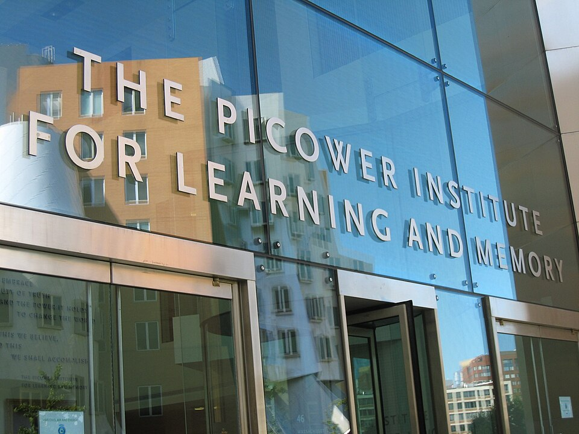

# What a Wrong Answer Reveals About the Brain's Timing

A 2022 Self Aware Networks note proposed that neural groups change partners as a task changes. An MIT primate study found a clue in what happens after a mistake.

**SVGN.io News Interactive | Neuroscience**

In September 2022, Micah Blumberg proposed a way for the brain to switch tasks: change the timing of activity across groups of neurons. In a [dated Self Aware Networks (SAN) note](https://github.com/v5ma/selfawarenetworks/blob/7129fcf82a9d42665a1372ecdc803e912bc81b6a/a0310zNAPOT5.md#L52-L64), he suggested that inhibition could help realign which cortical groups work together. The testable question was not whether brain waves exist. It was whether the pattern of cooperation changes when the brain has something new to do.

The Git record preserves that wording on September 17, 2022, Pacific time. It does not establish when it first became public. The note [discusses earlier theta and gamma studies](https://github.com/v5ma/selfawarenetworks/blob/7129fcf82a9d42665a1372ecdc803e912bc81b6a/a0310zNAPOT5.md#L136-L144) alongside its own proposal about how groups coordinate as a task changes. A [November 9 report from MIT](https://picower.mit.edu/news/timely-far-reaching-theta-waves-help-organize-cognition-study-shows) gives that idea a particularly sharp example to compare it with: what happens after an animal gets an answer wrong.

## An error changes the route

Matthew Broschard, Scott Brincat, Roman Loonis and Earl Miller trained nonhuman primates to classify patterns of dots. In their [Cell Reports study](https://doi.org/10.1016/j.celrep.2026.118262), the researchers examined activity in the frontal eye fields, which help direct the eyes, and two areas of prefrontal cortex: a dorsolateral area and a ventrolateral area. They asked which information was tied to theta, a rhythm of about four to ten cycles per second. During a choice, the timing of the rhythm in the frontal eye fields tracked neural activity carrying information about the choice. During feedback, it tracked information about the outcome.

*Earl K. Miller, senior author of the theta study, in an archival portrait. [Neocx](https://commons.wikimedia.org/wiki/File:Earl-miller-photo-3.jpg). [CC BY-SA 4.0](https://creativecommons.org/licenses/by-sa/4.0).*

The direction estimated from the recordings depended on the stage. During choices, the researchers found influence from both prefrontal areas toward the frontal eye fields. After correct outcomes, they reported the route from the dorsolateral prefrontal area to the frontal eye fields. After errors, influence in the other direction was stronger on a different route: from the frontal eye fields toward the ventrolateral prefrontal area. The result is not a blanket reversal across every pair. Which pair mattered was part of what changed.

The rhythm pairings also changed. Theta coupled with beta during choices and after errors. Beta coupled with faster gamma after correct outcomes. That is more informative than saying that slow rhythms and fast rhythms interact: the relevant pairing depended on what had just happened. The study appeared [as a preprint on June 4](https://doi.org/10.64898/2026.06.03.729810), and the journal published it online November 5. The November 24 issue date is not the first journal release.

## What the old idea would have to predict

The earlier SAN passages propose that timing and cooperation change with what the animal is doing. The new measurements specify the regional paths and rhythm pairings associated with each task stage. The study's estimate of direction comes from recorded activity. It does not, on its own, show that changing theta would produce the switch or identify the inhibitory neurons proposed in the note.

*MIT's Picower Institute in Cambridge, photographed in 2006. This is the institute's entrance, not the experiment. [Alan Levine](https://commons.wikimedia.org/wiki/File:Picower_Institute-20060913.jpg). [CC BY 2.0](https://creativecommons.org/licenses/by/2.0). Wikimedia web-size rendition; no crop.*

The next useful experiment would start by naming the route and the moment. Change the timing of activity in a specified circuit during feedback, then ask whether the expected signal gets through and whether that changes the animal's next choice. A perturbation that affects every stage alike would tell a different story from one that changes only how an error is handled.

That's why the wrong answer is more revealing than a picture of a brain wave. It gives researchers a particular moment, a particular route and an outcome against which to test an old idea about flexible cooperation.

*Disclosure: Micah Blumberg, the author of the Self Aware Networks work discussed here, publishes SVGN.io.*
